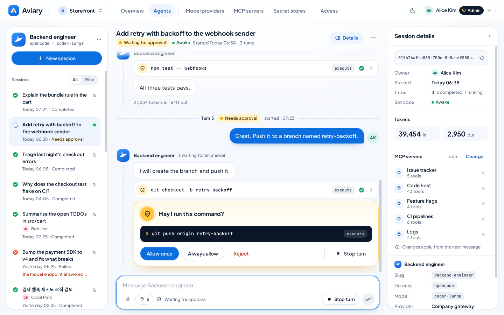

<p align="center">
  
</p>
<h1 align="center">Aviary</h1>
<p align="center">
  AI agent harnesses on Kubernetes, each session in a sandbox of its own.
</p>

Aviary runs AI agent harnesses, such as OpenCode, Codex and Claude Code, on
Kubernetes. You connect your model providers, describe your agents, and give
them work in a web UI or through an API. Each conversation is a session with
a sandbox of its own: a pod that runs the agent's harness, with a volume
that keeps the conversation and the files of the session between turns.

<picture>
  <source media="(prefers-color-scheme: dark)" srcset="docs/src/assets/screens/session-dark.png">
  
</picture>

> **Status:** Aviary is at an early stage and has only run on a local
> cluster. See its
> [limitations](docs/src/content/docs/start/overview.md#limitations).

## Why Aviary

- **Sessions that last.** A session keeps its conversation and its files
  across turns. One that is not in use is put to sleep: its pod is deleted,
  so it uses no CPU or memory, and its next turn continues in a new pod.
- **No keys in sandboxes.** A project registers its model providers, and no
  sandbox holds a provider's API key: the key is put into a model request on
  its way out.
- **Controlled egress.** An agent reaches only the hosts that the
  installation allows, and every request that leaves a sandbox is logged
  with the turn and the user that it came from.
- **A person in the loop.** An agent can be made to ask before it acts, and
  its turn waits for the answer.
- **Made for many users.** With an identity provider, callers are
  authenticated and limited to what their role allows in each project. The
  turns that run at once are limited, and further turns wait in order.
- **Your harnesses, models and infrastructure.** A harness is an image that
  speaks the [Agent Client Protocol](https://agentclientprotocol.com). A
  model provider is a URL and a key: a provider's API, an AI gateway or your
  own model server. The database and the event log are reached through
  plugins.

## Who it is for

- **People who give agents work.** Register your model providers and MCP
  servers, describe your agents, and work with them in the web UI. Aviary
  runs in a Kubernetes cluster today, which the quick start creates on your
  machine.
- **Platform engineers.** Run agents for the users of an organization on a
  cluster of your own: connect Aviary to your database, identity provider
  and storage, and decide what the sandboxes run and reach.
- **Contributors.** See how the parts fit together, build and test them, and
  add a harness or a plugin.

## Quick start

```sh
make cluster-up        # create a kind cluster
make postgres valkey   # install a database and an event log in it
make images            # build the images and load them into the cluster
make deploy            # install Aviary with its Helm chart
make web               # build the web UI and install it
```

The web UI is then at http://localhost:8082. Add a model provider, create an
agent and send it a message. The
[quick start](docs/src/content/docs/start/quick-start.md) lists what your
machine needs, and has the details.

## Documentation

- **Start here:**
  [What is Aviary](docs/src/content/docs/start/overview.md) ·
  [Quick start](docs/src/content/docs/start/quick-start.md) ·
  [Concepts](docs/src/content/docs/start/concepts.md) ·
  [How it works](docs/src/content/docs/start/how-it-works.md)
- **Use:**
  [The web UI](docs/src/content/docs/use/web-ui.md) ·
  [Agents](docs/src/content/docs/use/agents.md) ·
  [Sessions and turns](docs/src/content/docs/use/sessions.md) ·
  [Model providers](docs/src/content/docs/use/model-providers.md) ·
  [MCP servers](docs/src/content/docs/use/mcp-servers.md)
- **Operate:**
  [Installation](docs/src/content/docs/operate/installation.md) ·
  [Authentication](docs/src/content/docs/operate/authentication.md) ·
  [Network and egress](docs/src/content/docs/operate/egress.md) ·
  [Sessions and storage](docs/src/content/docs/operate/storage.md) ·
  [Harness images](docs/src/content/docs/operate/harness-images.md) ·
  [Plugins](docs/src/content/docs/operate/plugins.md)
- **Contribute:**
  [Contributing](docs/src/content/docs/contribute/overview.md) ·
  [Development environment](docs/src/content/docs/contribute/development.md) ·
  [Testing](docs/src/content/docs/contribute/testing.md)
- **Reference:**
  [API](docs/src/content/docs/reference/api/overview.md) ·
  [Configuration](docs/src/content/docs/reference/configuration.md) ·
  [Metrics](docs/src/content/docs/reference/metrics.md)

The pages are in [`docs/`](docs), and `make docs-dev` serves them as a site
at http://localhost:4321.

## License

[Apache License 2.0](LICENSE)
