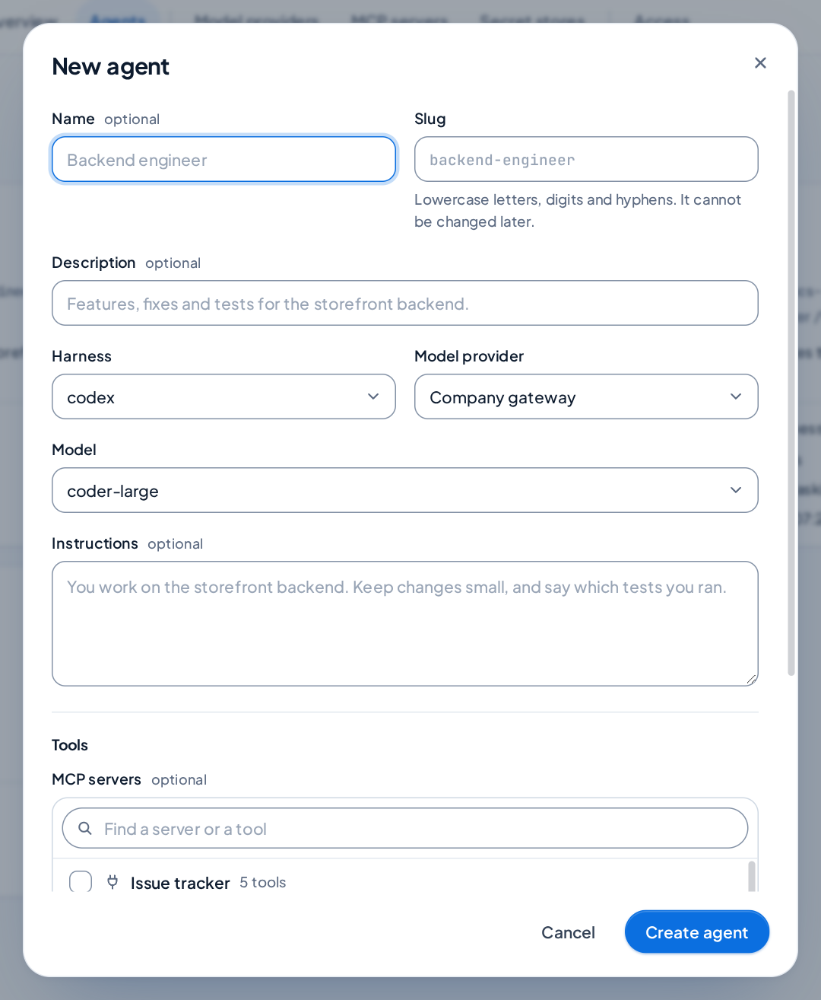

An agent is what a session talks to. It names:

- **A harness**, the agent program that runs its turns: one of those that
  the installation offers, such as `opencode`, `codex` or `claude-code`.
- **A model**: a [model provider](./model-providers.md) of the
  project, and the provider's name for the model.
- **Instructions**, if it needs them, which are given to the agent before
  every turn.
- **Approval.** An agent that asks does so before it acts, and a person
  answers: see [Approvals](./approvals.md). Any other agent asks
  nobody.
- **MCP servers**, if it needs them: the
  [servers](./mcp-servers.md) of the project that its sessions
  begin with.

An agent also has a slug, which is unique in its project, and can have a
name and a description, which says what the agent is for. The name and the
description are only for display.

## Creating an agent

In the web UI, **New agent** asks for these. The models to choose from are
those that the provider lists, and a provider that lists none takes the name
of a model as you enter it. Creating and changing agents needs the
permission `agents.manage`.

## Changing an agent

**Edit agent**, in the menu of an agent, changes all of it but its slug and
its harness. The sessions of the agent run their next turn with the change.
That turn gets a new harness, which resumes the session, if the model, the
instructions or the approval changed.

## Deleting an agent

**Delete agent** ends the sessions of the agent as when their owners end
them: their sandboxes are deleted, and their conversations stay readable.
The slug of a deleted agent is free for another agent. Since the sessions of
every member end, deleting an agent also needs the permission
`sessions.control_all`, and an agent cannot be deleted while a turn of one
of its sessions has not ended.

With the API, see [Agents](../reference/api/agents.md).
