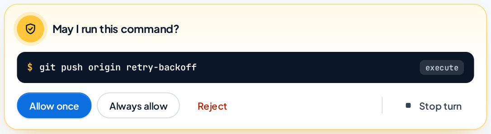

An agent acts without asking: it reads and changes files, runs commands and
calls the tools of MCP servers by itself. Its harness may still ask a person
what only a person can decide, such as whether to carry out a plan. The
turn then emits `approval.requested`, and the harness waits. A client
answers with `POST /v1/turns/{id}/approvals/{request}` and one of the
options that the harness offered. The harness continues with that answer,
and the turn emits `approval.resolved`, which says who answered. While a
request waits, it is listed in the turn's `approvals`, both in
`GET /v1/turns/{id}` and in the session's list of turns, so a client that
connects later can find it.

In the web UI, the request shows in the conversation with what the agent is
about to do and the answers that its harness offers, and the overview of the
project says that an agent is waiting for you.

- **What a harness asks depends on the harness** and on how its image
  configures it. Aviary passes the requests and the answers on unchanged.
  The images in this repository start their harnesses so that they do not
  ask before what the agent does: see
  [Harness images](../operate/harness-images.md). Claude Code still asks
  whether to carry out a plan that it made in plan mode, and before a few
  actions that it has a person confirm in any mode.
- **A request waits until a person answers it.** With `memory` snapshots,
  the default, the session sleeps after it has waited for
  `sandboxes.idleSeconds`, and the answer wakes it where it was. The time
  spent waiting does not count toward `runtime.maxTurnSeconds`. With other
  snapshots the sandbox keeps running, the time counts, and a turn whose
  time runs out while it waits fails as `timed_out`. Cancelling the turn
  ends its requests as `cancelled`.
- **What an option does depends on the harness too.** After a refusal,
  Claude Code tells the model and goes on, but a refused plan ends the turn.
  The answer to a plan also says how Claude Code goes on: with “Yes, and
  bypass permissions” it keeps acting without asking, and with “Yes,
  manually approve edits” it asks before its actions for the rest of the
  session.
- **Approval is not a security boundary.** The harness that asks runs in
  the sandbox, next to the agent's tools and as the same user. Approval
  keeps a well-meaning agent from acting on a mistake. What a sandbox can
  reach is limited by its egress policy, whatever was approved.
