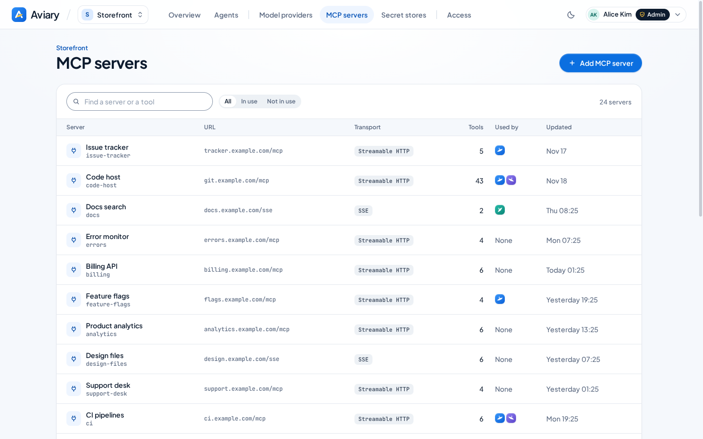

A project registers MCP servers by their URL.

## Adding a server

In the web UI, **Add MCP server** under **MCP servers** asks for a slug, the
URL, the transport and the headers that the server needs. **Test
connection** lists the tools of the server before it is saved. The list of
servers shows the tools of each and the agents that use it. With the API,
see [MCP servers](../reference/api/connections.md#mcp-servers).

An agent is given its servers when it is created or changed, and a session
turns servers on and off in its details, from its next message on.

## How servers behave

- **A server is reached by Streamable HTTP or by SSE.** A server that runs
  as a process of its own, over stdio, cannot be registered.
- **Its slug names it to a harness**, which names the server's tools after
  it, and so it does not change.
- **Its headers are as those of a provider**, and `authorization` is one of
  them, since a server takes its token there. A value that is a secret is
  stored or kept in a secret store, and stays while the URL does. A header
  of MCP itself, such as `mcp-session-id`, cannot be one of them.
- **Its tools are listed when it is registered and replaced**, and on
  request. The Supervisor asks the server itself, with the server's headers,
  so a server that it does not reach, or a token that the server refuses,
  shows at once. A server is registered all the same if it does not answer,
  and keeps the tools that it last listed while its URL stays the same.
- **The host of a server is a name**, as that of a model provider is: the
  sandboxes of the sessions that have it on may reach it.
- **An agent names the servers that its sessions begin with**, and a
  session turns any server of the project on or off. A session keeps only
  how it differs from its agent, and follows the agent in the rest. A
  server that is deleted leaves the agents and the sessions that had it.
- **A turn's harness reaches the servers that its session has on** at
  their URLs, with their headers. In place of a secret it sends a
  placeholder, and the egress gateway puts the secret in while the session
  has the server on, so a server that is turned off during a turn gets no
  secret from then on. A harness has the servers of its start: the turn
  after a change gets a new harness, which resumes the session. A harness is
  not given servers of a transport that it does not support, and each of its
  turns names them in an `mcp.unsupported` event.
- **A server whose header clashes at its host is left out of a turn.** The
  egress gateway puts a secret into a header of every request to the host
  and port of the secret, so a server at the host of the model provider, or
  of another server of the session, cannot have a header of the same name
  as one of theirs when either has a secret.
