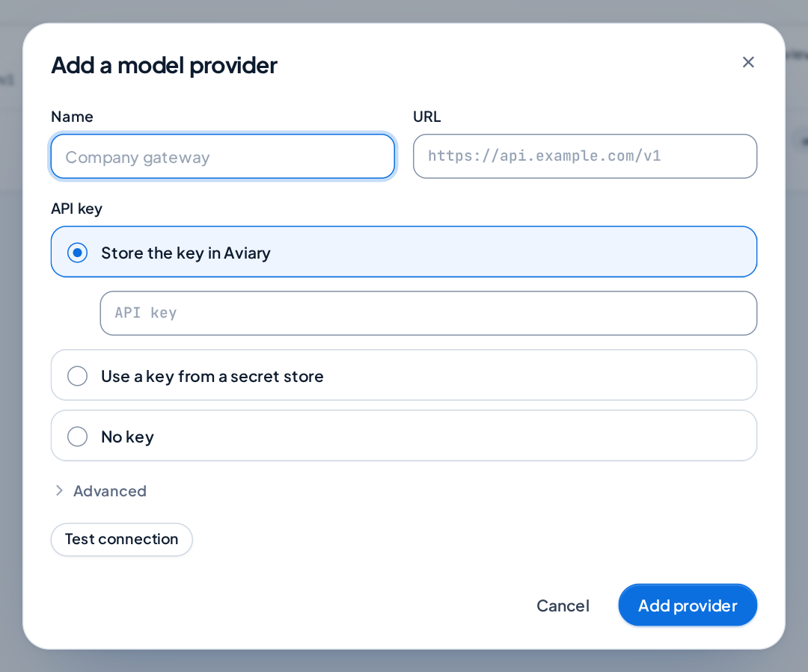

A model provider is the base URL of a model endpoint and its API key: a
provider's API, an AI gateway or your own model server. A project registers
its providers, and each agent names its model at one of them.

The turns of an agent send their model requests to the endpoint of the
agent's provider, for the agent's model.

## Adding a provider

In the web UI, **Add provider** under **Model providers** asks for a name,
the URL and the key. The key is stored in Aviary, read from a
[secret store](./secret-stores.md) of the project, or left out for
an endpoint that takes none. The headers that an endpoint needs besides its
key are under **Advanced**. **Test connection** lists the models of the
endpoint before the provider is saved. With the API, see
[Model providers](../reference/api/connections.md#model-providers).

Which API an endpoint must serve depends on the harness of the agents that
use it: see [the harness images](../operate/harness-images.md#the-images-in-this-repository).

## How providers behave

- **Secrets are write-only.** A key, or the secret of a header, is stored
  encrypted with a key of the installation, which the database does not
  hold. A provider is returned with `{"stored": true}` in its place, as
  `"api_key": {"stored": true}`.
- **A stored secret stays with its URL.** A provider that is replaced keeps
  a secret that is given as `{"stored": true}`, but only if its URL stays
  the same: a secret goes to no endpoint that it was not given for.
- **A secret can stay in a secret store of the project.** Aviary then
  stores where the secret is, not the secret, and reads it from the store
  when a model request needs it. See [Secret stores](./secret-stores.md).
- **A key goes only to its endpoint.** The Egress Proxy adds it to the model
  requests of the turns that use the provider, and forwards them to the
  host of the provider's URL, under the URL's path. Nothing else that a
  sandbox sends carries a key, and a sandbox cannot choose where its model
  requests go.
- **An endpoint can need headers besides its key**, as a gateway does that
  routes its requests by a header. A provider has up to 20 of them, as
  `"headers": [{"name": "x-gateway-route", "value": "team-a"}]`, and the
  Egress Proxy sets them on the model requests of the turns that use the
  provider, in place of what a sandbox sends by those names. A header that
  says where a request goes or how it is carried, such as `host`, cannot be
  one of them, nor can `authorization`, which carries the key. A value that
  is a secret is given as a key is, as
  `{"name": "x-team-token", "secret": {"value": "..."}}` or by its location
  in a secret store. Other values are not secrets: a provider is returned
  with them.
- **A provider can be replaced while turns use it.** Their next model
  request uses the new endpoint, headers and key.
- **The models of a provider can be listed**, before it is registered and
  after. The request goes to its endpoint the way a model request of a turn
  does, so an endpoint that the Egress Proxy does not reach, or a key that
  the endpoint refuses, shows at once and not as a failed turn. An endpoint
  that has no list of models answers 404, and was reached all the same.
- **The host of a provider is subject to `egressProxy.allowedHosts`** like
  any other host: if the list names hosts, it must allow the provider's.
- **A provider at `localhost` reaches nothing**, since to the Egress Proxy
  that is the proxy itself, unless `egressProxy.localhost` names the host
  that stands in for it. The proxy then connects to that host, on the port
  of the provider's URL.
