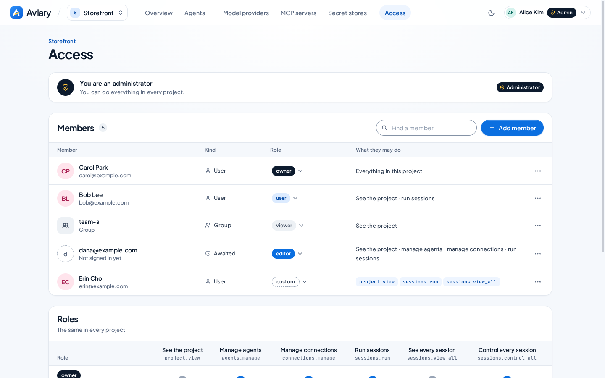

A project holds the model providers, MCP servers, secret stores and agents
of a team, and the members who may use them. Administrators create
projects: in the web UI with **New project**, which asks for a slug and,
optionally, a name.

A project's slug is 1 to 63 lowercase letters, digits and hyphens, beginning
with a letter and not ending with a hyphen. It is unique in the installation
and cannot be changed. The name is only for display.

## Permissions

A role is a named set of permissions in a project. Administrators create
projects, manage their members and change the permissions of the roles.
Everything else needs a permission in the project:

| Permission | Allows |
| --- | --- |
| `project.view` | Viewing the project and its agents, model providers, MCP servers and secret stores, without their secrets. Every member has it. |
| `agents.manage` | Creating and changing agents in the project, and listing the models of its providers. Deleting an agent also needs `sessions.control_all`, since it ends the sessions of every member. |
| `connections.manage` | Registering and replacing the project's model providers, MCP servers and secret stores, deleting its MCP servers, and listing the models of an endpoint or the tools of a server that is not registered. |
| `sessions.run` | Creating sessions, and in one's own sessions: sending messages, stopping turns, answering approval requests, reading the conversation, changing the title and ending the session. |
| `sessions.view_all` | Reading the sessions of other members. |
| `sessions.control_all` | Stopping the turns of other members, answering their approval requests, and changing the titles of their sessions and ending them. Includes `sessions.view_all`. |

## Members

A member is a user, by username, or a group of the identity provider, which
includes everyone that the provider puts in it. A member has a role, or
permissions of its own, shown as `"role": "custom"` with the permissions. A
member with a role has whatever the role allows at the time. A member with
permissions of its own keeps them as they were given.

A user can be made a member before their first request: the user who is
then seen with that username becomes the member. From then on the
membership belongs to that user, not to the username: if the provider gives
the username to someone else, the member is still the original user, and
the other is not a member.

In the web UI, **Access** lists the members of a project with what each may
do, and an administrator adds a person or a group there.

## Sessions of other members

A session belongs to the caller who created it, and only that caller can
send it messages. Reading one's own session, stopping its turns, answering
their approval requests, changing its title and ending it need
`sessions.run`. For the sessions of other members, reading needs
`sessions.view_all`, and stopping, answering, changing the title and ending
need `sessions.control_all`.

## Roles

There are exactly five roles. An administrator can change the permissions
of a role with `PUT /v1/roles/{name}`, which applies to everyone with the
role from then on. The defaults are:

| Role | Permissions |
| --- | --- |
| `owner` | All of them. |
| `editor` | `project.view`, `agents.manage`, `connections.manage`, `sessions.run` |
| `user` | `project.view`, `sessions.run` |
| `viewer` | `project.view` |
| `auditor` | `project.view`, `sessions.view_all` |
