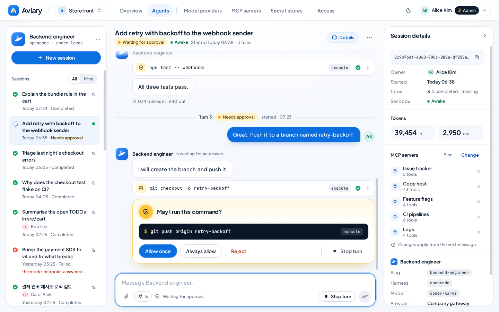

A session is one conversation with an agent. It belongs to the user who
created it, and only that user can send it messages. Each message is a
turn.

## Starting a session

**New session**, next to the sessions of an agent, starts one. A session
begins with the MCP servers of its agent. Its title is only for display and
can be changed at any time, also after the session has ended.

## Sending a message

A message is a text, files, or both. A session runs one turn at a time: it
takes the next message when its last turn has ended.

A turn runs as soon as a worker has room for the session's sandbox, at once
if the sandbox is awake. Until then it is queued, and queued turns run in
the order in which they were sent: the turn's
[events](../reference/api/events.md) tell its place in the queue. A turn
that waits for too long expires, and if too many turns are queued, new
messages are refused for the moment. The limits are
`runtime.maxQueueWaitSeconds` and `runtime.maxQueuedTurns` in the
[configuration](../reference/configuration.md#runtime).

## Files

A message carries files that are attached to it, dropped on it or pasted
into it: by default up to 10 files of up to 64 MiB each.

- **The agent finds them in its home.** Before the turn starts, the files
  are written into the session's sandbox at `/home/.attachments/<seq>/<name>`,
  where `seq` is the number of the turn, and they stay there for the turns
  that follow. The harness gets the text and after it a link to each file,
  in the order of the message, so that the agent knows which files came with
  the message, and which of them is the second.
- **What an agent makes of a file depends on its harness and its model.**
  One harness gives its model the file with the message, another a link
  that the model follows with a tool, and a picture needs a model that takes
  pictures. See
  [Harness images](../operate/harness-images.md#what-to-watch-for).
- **The files are kept until the session ends.** Until then, those who may
  read the session can download them. The web UI shows the pictures, PDFs
  and texts among them over the page.

## The workspace

The agent of a session works in `/home/workspace` of its sandbox, and what
it leaves there stays for the turns that follow. **Files** in the web UI
shows that directory beside the conversation, and follows what the agent
does there.

- **Looking.** The tree opens the directories in place, and finds files by
  their names. A file opens in a tab: a text as it is written, and a
  Markdown file, a web page, a picture and a PDF as what they make. Of a
  long text, the first mebibyte shows.
- **Taking files out.** A file is downloaded as it is, and a directory, or
  the whole workspace, as a ZIP file.
- **Putting files in.** Those who may send the session messages upload
  files and folders, from the menu of the tree or by dropping them on it:
  by default up to 256 MiB each, which is `runtime.maxFileBytes` in the
  [configuration](../reference/configuration.md#runtime). A file replaces
  one of its name only after you agree.
- **While the session sleeps.** Looking at its files wakes its sandbox, as
  a message does, if a worker has room for it.
- **When the session ends**, its files are deleted with its sandbox.

The API has the same: see
[Workspace](../reference/api/sessions.md#workspace).

## Following a turn

While a turn runs, the conversation shows what the agent says and thinks,
the tools that it calls with their input and output, its plan, and what its
harness asks you. When the turn has ended, it shows the tokens that the
harness reported for it, which is not a measurement.

**Stop turn** cancels the turn. A queued turn ends at once. A running turn
is told to stop, and ends when its harness has stopped.

A turn ends as completed, failed, cancelled or expired. A turn that did not
complete keeps what happened until then. [Turn records](../reference/api/turns.md#turn-records)
describes how a turn ended, and
[Failure reasons](../reference/api/events.md#failure-reasons) why a turn
failed.

## The sandbox of a session

A session works in a sandbox of its own, which the details of the session
show as:

| Sandbox | Meaning |
| --- | --- |
| Awake | The sandbox of the session runs on a worker. |
| Asleep | The session was not in use, and a snapshot keeps its sandbox with the agent's files. The next message wakes the session. |
| Lost | The sandbox is gone although the session has not ended, as after it was deleted in Agent Substrate. Everything that the agent had in it is gone, and the next turn gets a new sandbox. |

The first turn after a sleep may take longer, since the sandbox wakes first.
See [Sessions and storage](../operate/storage.md) for when a session
sleeps and what its snapshot keeps.

## MCP servers of a session

The details of a session list the MCP servers that it has on, and turn any
server of the project on or off for it. A change applies from the next
message. See [MCP servers](./mcp-servers.md).

## Ending a session

**End session**, in the menu of a session, deletes its sandbox with its
snapshot and everything that the agent had in it. The conversation stays
readable, and the session accepts no more messages. A session cannot be
ended while a turn of it has not ended.

A session also ends when its agent is deleted and, if the installation says
so, when it has not been used for a long time.

With the API, see [Sessions and messages](../reference/api/sessions.md).
