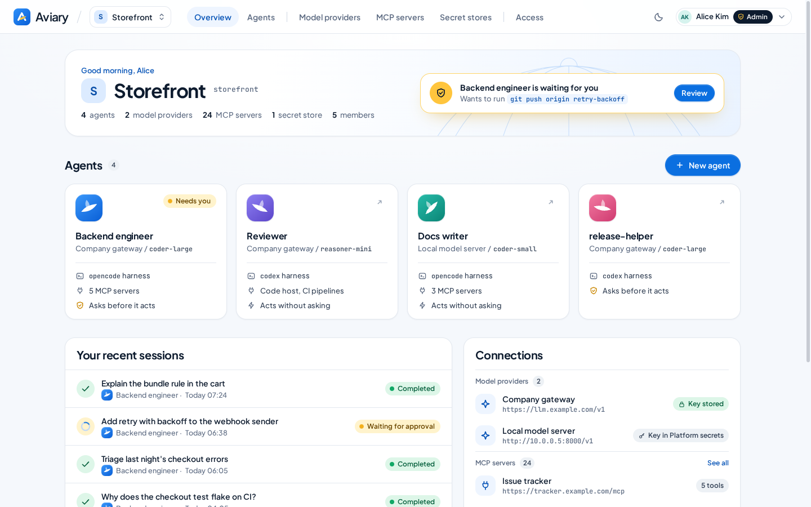
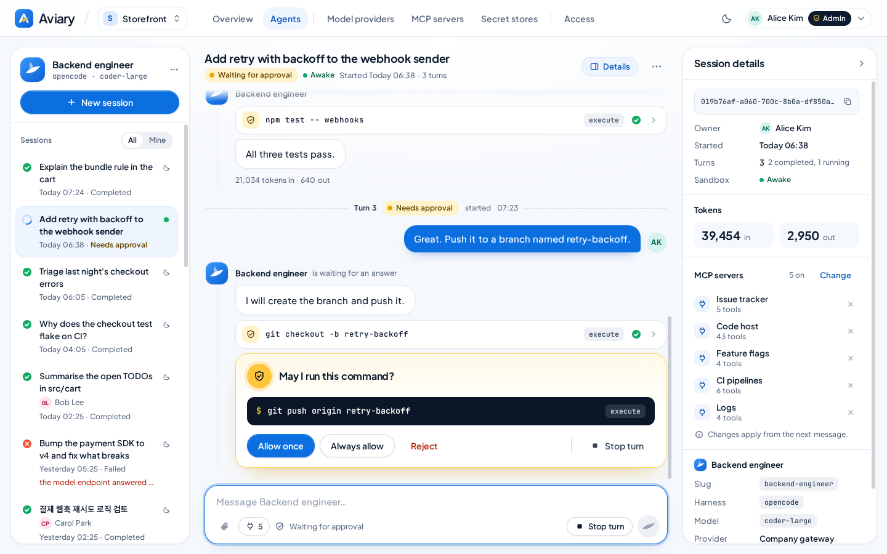

The web UI is a client of the API that runs in the browser. It shows the
projects with their members, model providers, MCP servers, secret stores and
agents, and the sessions of an agent with their conversations and the MCP
servers that each has on: it attaches files to a message, opens the
pictures, PDFs and texts among the files of the messages, follows a turn as
the agent works, and answers its requests for approval.

## Signing in

If the installation has an identity provider, the web UI sends you to it to
sign in, and you come back signed in. If it has none, nobody signs in, and
everyone is an administrator. The menu at the top right shows who you are to
Aviary, with your groups, and signs you out.

What you see and what you may change depend on your
[role](./projects.md#roles) in the project.

## Finding your way

You first choose a project, and can change it at any time next to the logo.
The tabs of a project are:

- **Overview.** The agents of the project, your recent sessions and its
  connections. A turn that waits for your answer shows at the top.
- **Agents.** The [agents](./agents.md) of the project. Opening one
  shows its sessions.
- **Model providers**, **MCP servers** and **Secret stores**. What the
  agents of the project are connected to: see
  [Model providers](./model-providers.md),
  [MCP servers](./mcp-servers.md) and
  [Secret stores](./secret-stores.md).
- **Access.** The [members](./projects.md) of the project and their
  roles.

## Working with an agent

- **On the left** are the sessions of the agent, yours or everyone's, each
  with the state of its last turn. A dot marks a session whose sandbox is
  awake, and a moon one that sleeps. **New session** starts a conversation.
- **In the middle** is the conversation: for each turn your message, what
  the agent says, the tools that it calls, and what it asks you before it
  acts. Under it you write the next message, attach files, and stop the turn
  that runs. See [Sessions and turns](./sessions.md).
- **On the right**, **Details** shows the session with its owner, its
  sandbox and the tokens that its turns used, the MCP servers that it has
  on, and the agent.

## Themes

The web UI has a light and a dark theme, which the button next to your name
switches.
